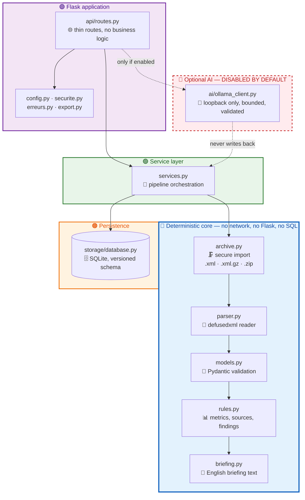
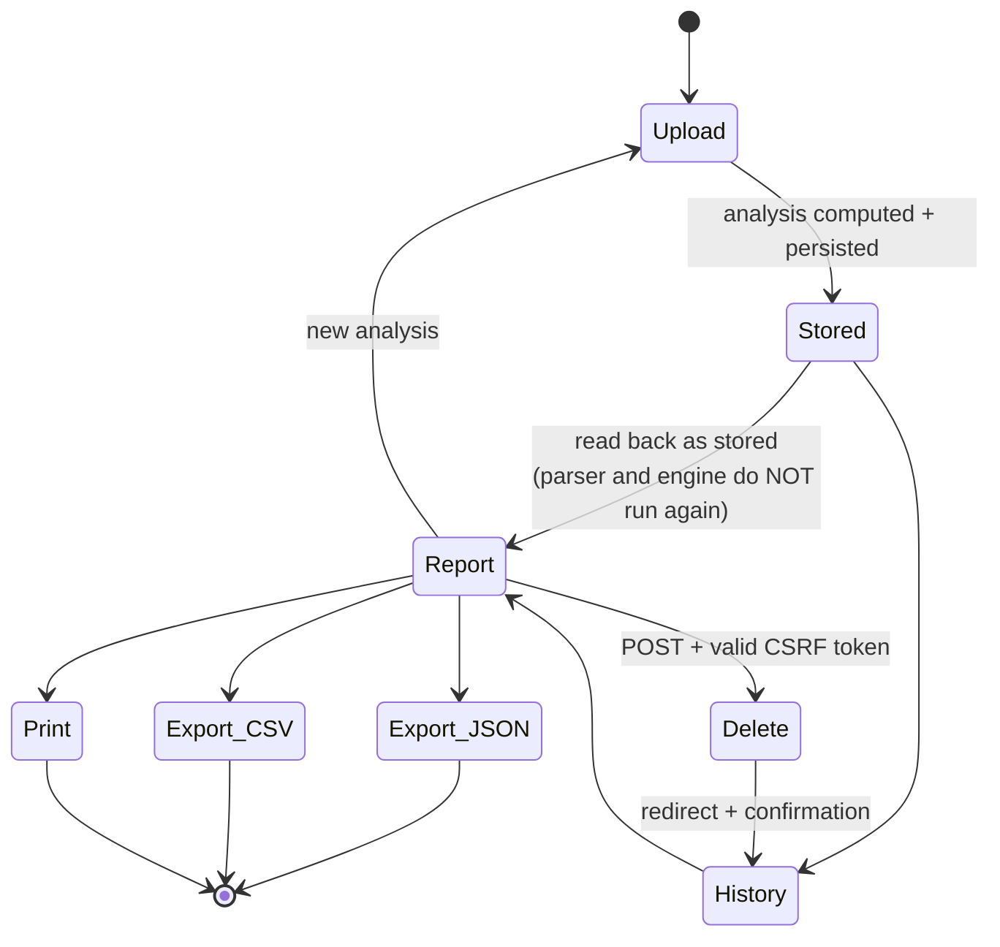
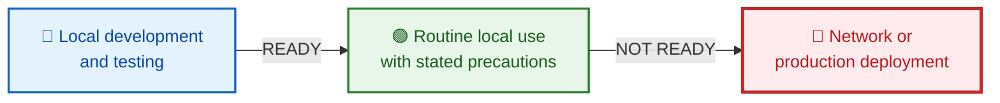

<div align="center">

# 🛡️ MailGuard Digest

**Local, deterministic analysis of DMARC aggregate reports**

*Import `.xml` / `.xml.gz` / `.zip` → verified metrics → traceable findings → printable report*

<br>

[](https://www.python.org/)
[](https://flask.palletsprojects.com/)
[](LICENSE)
[](app/ai/)
[](app/storage/database.py)

</div>

---

## 📑 Table of contents

| Section | Content |
| :-- | :-- |
| [🔐 Security model](#security-model) | What is guaranteed, what is not |
| [⚡ Quick start](#quick-start) | 4 commands to a running application |
| [🏗️ Architecture](#architecture) | Module map and boundaries |
| [🔄 Pipeline](#pipeline) | The complete processing chain |
| [📊 Features](#features) | Formats, metrics, findings |
| [🖥️ Web routes](#web-routes) | Every endpoint, every method |
| [🔧 Configuration](#configuration) | Every variable, every default |
| [🧪 Testing](#testing) | Exact commands and observed results |
| [🤖 Optional AI narration](#optional-ai-narration-ollama) | Opt-in, isolated, never authoritative |
| [🖨️ Print & export](#print--export) | Browser print, JSON, CSV |
| [🩺 Troubleshooting](#troubleshooting) | Evidence-based fixes |
| [⚠️ Known limitations](#known-limitations) | What has **not** been verified |
| [🚦 Readiness verdict](#readiness-verdict) | Local vs. network exposure |
| [📚 Reference kit](#reference-kit) | The project contract documents |

---

<a id="security-model"></a>

## 🔐 Security model

> **Reports are untrusted input.** They are never trusted, never executed, and never retained.

| Guarantee | How it is enforced | Where |
| :-- | :-- | :-- |
| 🛡️ **No XML attack surface** | `defusedxml` with `forbid_dtd`, `forbid_entities`, `forbid_external` | `app/core/parser.py` |
| 📦 **No unsafe ZIP extraction** | Members read **in memory**; no `extractall()`, no disk path from a member name | `app/core/archive.py` |
| 🧮 **Bounded resources** | 12 MiB request · 10 MiB upload · 50 MiB decompressed · 100 entries · 20 reports · **10 000 records/report** | `app/config.py` |
| 🔑 **CSRF on every state change** | `secrets.token_urlsafe` + `compare_digest`; deletion exists **only** as POST | `app/securite.py` |
| 🧼 **Output always escaped** | No `safe` filter, no `Markup()`, no `` block anywhere in `app/` | `app/templates/` |
| 🗄️ **Parameterized SQL** | Placeholders everywhere; only `PRAGMA user_version = <int>` is interpolated | `app/storage/database.py` |
| 🚫 **No raw XML storage** | Only the SHA-256, a sanitized filename, the date and the computed results | `app/storage/database.py` |
| 🌐 **No remote analysis API** | The single HTTP client targets a loopback Ollama endpoint, disabled by default | `app/ai/ollama_client.py` |
| 🔒 **Strict CSP** | `default-src 'none'` — no `unsafe-inline`, no `unsafe-eval`, no remote asset | `app/erreurs.py` |
| 🧾 **No raw traceback in the UI** | Business errors show their own message; unexpected errors show a generic one | `app/__init__.py` |

<details>
<summary><b>🔴 What this application is <em>not</em></b></summary>

- ❌ **Not authenticated.** There are no accounts, roles or API tokens. Anyone who can reach the port can **import, read and delete** analyses. Loopback binding is the only protection.
- ❌ **Not production-ready.** It runs on the Werkzeug development server, which says so itself.
- ❌ **Not a security verdict.** A DMARC `fail` is **not** proof of malicious activity; a DMARC `pass` is **not** a guarantee of safety.
- ❌ **Not a policy adviser.** It never recommends switching to `p=quarantine` or `p=reject`.

</details>

---

<a id="quick-start"></a>

## ⚡ Quick start

```bash
# 1 ── Enter the repository
cd mailguard-digest

# 2 ── Create and activate the virtual environment
python3 -m venv .venv
source .venv/bin/activate          # Bash on Kali; otherwise call .venv/bin/python directly

# 3 ── Install dependencies (no sudo, ever)
python3 -m pip install --upgrade pip
python3 -m pip install -r requirements-dev.txt

# 4 ── Configure — the application refuses to start without a secret
cp .env.example .env
python3 -c "import secrets; print(secrets.token_hex(32))"   # paste into FLASK_SECRET_KEY= in .env

# 5 ── Run
.venv/bin/python -m app.main
```

> ⚠️ **The project runs from the sources.** `pyproject.toml` declares **no `[build-system]` table**, so `pip install .` and `pip install -e .` **fail**. Installing from the requirements files is the only supported method.
> ℹ️ Runtime only, without the test tools: `python3 -m pip install -r requirements.txt`
> ℹ️ Verify: `python3 -c "import flask, pydantic, defusedxml, requests, dotenv; print('OK')"`
> 🚫 Never run `sudo pip install`. No system package is required: no Docker, no Node, no compiler.

<div align="center">

### 🌐 <http://127.0.0.1:5000/>

</div>

**Startup checklist**

```bash
curl -s -o /dev/null -w "%{http_code}\n" http://127.0.0.1:5000/    # must print 200
ls -l data/mailguard.sqlite3                                          # created automatically
```

> ℹ️ There is **no health endpoint** and **no dedicated database command** — the schema is created or upgraded automatically at startup, and startup must be confirmed by the two commands above.
> ℹ️ The log line announcing database initialization is **never emitted** (Flask's effective log level is `WARNING`). This is documented, not assumed — see [`docs/FINAL_ACCEPTANCE_AUDIT.md`](docs/FINAL_ACCEPTANCE_AUDIT.md) §3.4.
> ℹ️ **Launch from the repository root**: `data/mailguard.sqlite3` is relative to the current directory.

---

<a id="architecture"></a>

## 🏗️ Architecture

**Deterministic core · optional AI narrative · local-only storage**



<div align="center">

**🔵 Deterministic core** is the only source of every figure.
**🔴 AI can only rephrase findings that already exist** — never calculate, correct or replace.

</div>

### 📦 Module responsibilities

| Module | Responsibility | Must never |
| :-- | :-- | :-- |
| `app/core/archive.py` | Read XML, GZIP and ZIP with limits | Write any member path to disk |
| `app/core/parser.py` | XML → validated model | Access Flask, SQL or network |
| `app/core/models.py` | Structures and business constraints | Invent a missing value |
| `app/core/rules.py` | Metrics, per-source views, findings | Qualify an address as malicious |
| `app/core/briefing.py` | Reformat findings into readable text | Compute anything |
| `app/storage/database.py` | Schema, insert, read, duplicate, delete | Concatenate user SQL |
| `app/api/routes.py` | HTTP orchestration and rendering | Contain business logic |
| `app/ai/*` | Optional local narration | Touch deterministic data |

---

<a id="pipeline"></a>

## 🔄 Pipeline

```mermaid
flowchart LR
    U(["📁 Upload<br/>.xml / .xml.gz / .zip"]) --> L["🔢 Limits<br/>size · members · reports<br/>records"]
    L -->|"refused"| E1(["⛔ Clear refusal"])
    L --> D["🗜️ In-memory decode"]
    D -->|"corrupt · nested ·<br/>encrypted · symlink<br/>path trap"| E1
    D --> P["📄 defusedxml<br/>DTD · entities · XXE blocked"]
    P -->|"malformed"| E2(["⛔ Parse refusal"])
    P --> V["🧱 Pydantic validation<br/>IP · counters · dates · enums"]
    V -->|"invalid"| E2
    V --> R["📊 Deterministic engine<br/>weighted metrics · findings"]
    R --> B["📝 Briefing"]
    R --> S[("🗄️ SQLite<br/>results only, no XML")]
    S --> H{"🤖 AI enabled?"}
    H -->|no| W["🖥️ Report page"]
    H -->|yes · unavailable| W
    H -->|yes · validated| N["💬 Narration<br/>ephemeral, never stored"] --> W
    W --> X(["📤 Print · JSON · CSV"])

    style U fill:#e3f2fd,stroke:#1565c0,color:#0d47a1
    style L fill:#fff8e1,stroke:#f9a825,color:#e65100
    style D fill:#fff8e1,stroke:#f9a825,color:#e65100
    style P fill:#fce4ec,stroke:#ad1457,color:#880e4f
    style V fill:#fce4ec,stroke:#ad1457,color:#880e4f
    style R fill:#e8f5e9,stroke:#2e7d32,color:#1b5e20
    style S fill:#fff3e0,stroke:#ef6c00,color:#e65100
    style W fill:#ede7f6,stroke:#4527a0,color:#311b92
    style X fill:#e0f7fa,stroke:#00838f,color:#006064
    style E1 fill:#ffebee,stroke:#c62828,color:#b71c1c
    style E2 fill:#ffebee,stroke:#c62828,color:#b71c1c
```



> 🔒 **The uploaded XML is never persisted.** Only the SHA-256 fingerprint, a sanitized filename, the import date and the computed deterministic results are stored.

---

<a id="features"></a>

## 📊 Features

### 📥 Accepted formats

| Format | Content | Notes |
| :-- | :-- | :-- |
| `.xml` | One DMARC aggregate report | Namespace optional |
| `.xml.gz` | One GZIP-compressed report | Decompression bounded block by block |
| `.zip` | **Several** XML reports, plus directories | Ordinary unsupported files are ignored **and listed** |

**Refused, always with a clear message**

`✗` nested archive · `✗` encrypted member · `✗` symbolic link or special file ·
`✗` path traversal (`../`), absolute path, Windows drive, ambiguous `//` ·
`✗` duplicate member name · `✗` corrupt or empty archive ·
`✗` DTD, entity or external reference · `✗` non-XML content behind a valid extension

> ⚠️ **One failing member fails the whole import.** No partial import is ever presented as a success.

### 📈 Deterministic metrics

Every figure is **message-weighted** — never an average of per-record rates.

| Metric | Rule |
| :-- | :-- |
| `total_messages` | `Σ record.message_count` |
| `messages_pass` | `Σ message_count` where **DMARC-evaluated** SPF **or** DKIM = `pass` |
| `messages_fail` | `total_messages − messages_pass` |
| `taux_pass` / `taux_fail` | `num / den × 100`, **`None` when `den == 0`** — never replaced by `0` |
| Dispositions | Summed **in messages** per `policy_evaluated.disposition` |
| Per source | Grouped by source IP, sorted by descending volume then address |

> 🔑 **Evaluated ≠ raw.** `policy_evaluated/spf|dkim` are DMARC verdicts (alignment already included); `auth_results/spf|dkim` are raw authentication results. They are stored separately and never mixed. A raw `softfail` is not a DMARC `fail`.

### 🔍 Findings

Each finding carries **measured evidence** and an **interpretation limit**:

- 📊 observed volume, records and reports
- ⚠️ DMARC failures observed — *a failure indicates no successful alignment; it does not qualify the origin*
- 🌐 sources associated with failures, with their measured volume — *never labelled malicious*
- 📋 dispositions declared by the reporting server
- ❓ rate not calculable when no message is counted
- 📜 published policy described **factually** — *no recommendation to change it*
- 🕳️ missing data reported as missing — *never estimated*

---

<a id="web-routes"></a>

## 🖥️ Web routes

Every route, its HTTP method and its CSRF requirement:

| Method | Route | Purpose | CSRF |
| :-- | :-- | :-- | :-- |
| `GET` | `/` | Overview, limits, scope | — |
| `GET` `POST` | `/upload` | Upload form and processing | **POST requires a token** |
| `GET` | `/history` | Stored analyses, newest first, bounded to 20 | — |
| `GET` | `/history/<id>` | Reopen a stored analysis | — |
| `POST` | `/history/<id>/delete` | Delete one analysis | **token required** |
| `GET` | `/history/<id>/export.json` | JSON export | — |
| `GET` | `/history/<id>/export.csv` | CSV export of sources | — |
| `GET` | `/static/css/style.css` | Local stylesheet | — |
| `GET` | `/static/js/print.js` | Local print script | — |



> 🔁 **Duplicate handling.** The SHA-256 is computed on the **exact received bytes**. Importing identical binary content again creates no new row: the page states *"already been imported"* and displays the existing analysis. The SQLite `UNIQUE` constraint is authoritative, including under concurrency. The same report supplied in a different container (XML vs ZIP) is a **distinct** row — deduplication is byte-level, not semantic.
> 🗑️ **Deletion is immediate and irreversible** — no trash, no undo. A `GET` on the delete route returns **405** and changes nothing.

---

<a id="configuration"></a>

## 🔧 Configuration

Copy the template and fill in the one required value:

```bash
cp .env.example .env
python3 -c "import secrets; print(secrets.token_hex(32))"
```

| Variable | Required | Default | Role |
| :-- | :--: | :-- | :-- |
| `FLASK_SECRET_KEY` | 🔴 **Yes** | — | Session and CSRF token signing. **≥ 32 characters.** Startup is refused if absent or short |
| `MAILGUARD_HOST` | 🟢 No | `127.0.0.1` | Listening address — **do not change**, see the warning below |
| `MAILGUARD_PORT` | 🟢 No | `5000` | Listening port, 1–65535 |
| `MAILGUARD_DATABASE_PATH` | 🟢 No | `data/mailguard.sqlite3` | SQLite file, **relative to the working directory** |
| `MAILGUARD_MAX_COMPRESSED_BYTES` | 🟢 No | `10485760` (10 MiB) | Maximum uploaded file size |
| `MAILGUARD_MAX_DECOMPRESSED_BYTES` | 🟢 No | `52428800` (50 MiB) | Cumulative decompressed volume |
| `MAILGUARD_MAX_ARCHIVE_MEMBERS` | 🟢 No | `100` | Maximum entries per ZIP |
| `MAILGUARD_MAX_REPORTS_PER_IMPORT` | 🟢 No | `20` | Maximum XML reports per import |
| `MAILGUARD_MAX_RECORDS_PER_REPORT` | 🟢 No | `10000` | Maximum `<record>` elements per report |
| `MAILGUARD_MAX_CONTENT_LENGTH` | 🟢 No | `12582912` (12 MiB) | Flask request cap — must stay ≥ the file limit |
| `FLASK_DEBUG` | 🟢 No | `0` | **Leave at `0`.** Enables an unaudited interactive debugger |
| `MAILGUARD_AI_ENABLED` | 🟢 No | `0` | `0` = no AI request, no model required |
| `MAILGUARD_OLLAMA_URL` | 🟡 If AI on | `http://127.0.0.1:11434` | Must be a loopback address unless `ALLOW_REMOTE=1` |
| `MAILGUARD_OLLAMA_MODEL` | 🟡 If AI on | *(empty)* | Must name a model **already present locally** |
| `MAILGUARD_OLLAMA_TIMEOUT_SECONDS` | 🟢 No | `10` | Bounded 0.5–120 s |
| `MAILGUARD_OLLAMA_MAX_INPUT_CHARS` | 🟢 No | `4000` | Bounded 200–20000 |
| `MAILGUARD_OLLAMA_MAX_OUTPUT_TOKENS` | 🟢 No | `300` | Bounded 32–2000 |
| `MAILGUARD_OLLAMA_ALLOW_REMOTE` | 🟢 No | `0` | **Leave at `0`.** `1` sends findings over the network |

> 🚫 **Never set `MAILGUARD_HOST=0.0.0.0`.** The application has no authentication and no authorization. Binding to a network interface would let anyone **delete** stored analyses.
> 🔒 An unreadable or inconsistent numeric value **refuses startup** and names the variable. No limit is ever silently disabled.
> 📄 `.env` is ignored by Git. **No secret must ever be committed.**

---

<a id="testing"></a>

## 🧪 Testing

No lint or type-check tool is configured in this project, so there is no `ruff`, `mypy` or `flake8` command to run.

```bash
# Complete suite — run from the repository root
.venv/bin/python -m pytest -q

# Compilation check
.venv/bin/python -m compileall -q app tests

# A single file
.venv/bin/python -m pytest -q tests/test_web.py
.venv/bin/python -m pytest -q tests/test_audit_etape11.py
```

| Date | Command | Observed result | Exit |
| :-- | :-- | :-- | :--: |
| 2026-10-16 | `.venv/bin/python -m pytest -q` | `417 passed` | `0` |
| 2026-10-16 | same, in a **fresh virtualenv** built from `requirements-dev.txt` | `417 passed` | `0` |
| 2026-10-16 | `.venv/bin/python -m compileall -q app tests` | no output | `0` |
| 2026-10-15 | `.venv/bin/python -m pytest -q` (step 0) | exit 5, no test collected — **historical only** | `5` |

| Suite | Tests | Suite | Tests |
| :-- | --: | :-- | --: |
| `test_models.py` | 37 | `test_database.py` | 41 |
| `test_parser.py` | 34 | `test_web.py` | 111 |
| `test_archive.py` | 59 | `test_ai.py` | 39 |
| `test_rules.py` | 36 | `test_audit_etape11.py` | 41 |
| `test_briefing.py` | 19 | **Total** | **417** |

> ✅ **0 skipped, 0 xfail, 0 deselected.** No test has ever been weakened or deleted to obtain a green suite.
> 📚 Full detail: [`docs/SECURITY_AUDIT.md`](docs/SECURITY_AUDIT.md) and [`docs/FINAL_ACCEPTANCE_AUDIT.md`](docs/FINAL_ACCEPTANCE_AUDIT.md).

---

<a id="optional-ai-narration-ollama"></a>

## 🤖 Optional AI narration (Ollama)

> **Deterministic core, optional AI narrative.** Every figure, verdict, policy value, finding and interpretation limit is produced by the deterministic engine. A local model may only **rephrase** findings that already exist.

<div align="center">

### 🔴 Disabled by default · 🔴 No model is ever downloaded · 🔴 Ollama is never launched

</div>

**Enable it** — explicit opt-in, nothing happens otherwise:

```bash
# 1 · Install Ollama separately and start it — the application never does this for you
ollama serve

# 2 · Download one model ONCE, by hand, then verify it is present
ollama pull <small-instruct-model>
ollama list
```

```bash
# 3 · In .env
MAILGUARD_AI_ENABLED=1
MAILGUARD_OLLAMA_URL=http://127.0.0.1:11434
MAILGUARD_OLLAMA_MODEL=<exact name shown by "ollama list">

# 4 · Restart the application
.venv/bin/python -m app.main
```

**Diagnose availability**

```bash
curl -s -m 3 -o /dev/null -w "%{http_code}\n" http://127.0.0.1:11434/   # 000 = service absent
ollama list                                                            # models available
```

**Turn it off again:** `MAILGUARD_AI_ENABLED=0`, then restart.

### 🛡️ Guarantees

| | |
| :-- | :-- |
| ✅ **Sent** | Finding identifier, severity label, title, description, interpretation limit — at most **12** findings, inside an explicit *untrusted data* block |
| 🚫 **Never sent** | Raw XML · archive contents · source records · **source IP addresses** · database content · file paths · environment variables · secrets · briefing text |
| 🔒 **Network** | Loopback only unless `ALLOW_REMOTE=1` · **no redirects** · **no retries** · environment **proxies bypassed** · response size and generation bounded |
| ✅ **Validated output** | Strict JSON schema · unknown fields refused · only identifiers **actually transmitted** are accepted · control characters refused · length bounded · no policy change and no source judgement |
| 🔁 **On failure** | Import still succeeds · deterministic report and briefing unchanged · page states *"Local AI is unavailable"* · a timeout is an optional-feature failure, never an analysis failure |
| 💨 **Ephemeral** | Generated once at import · **never stored, never exported, never re-requested** on reopening a report |

> 🧪 **What was actually tested:** the adapter, validation, fallback and UI with a **simulated** HTTP transport, plus real attempts against `127.0.0.1:11434` with nothing listening (connection refused) and a real read timeout. **No real model was ever downloaded or run.** A mocked test does **not** prove compatibility with a real Ollama model — see [`docs/FINAL_ACCEPTANCE_AUDIT.md`](docs/FINAL_ACCEPTANCE_AUDIT.md) §3.7.

---

<a id="print--export"></a>

## 🖨️ Print & export

**🖨️ Print report** — available on new and stored reports. Uses the browser's own print dialog; choose *"Save as PDF"* there. **No PDF engine runs on the server**, and the result is not a certified document. Without JavaScript, printing from the browser menu gives the same layout.

**📦 Download JSON** — `GET /history/<id>/export.json`, `application/json` attachment named `mailguard-analysis-<id>.json`:

```json
{
  "schema_version": 1,
  "exported_at": "…",
  "analysis_identifier": 12,
  "stored_at": "…",
  "stored_by_version": "0.1.0",
  "uploaded_file_name": "rapport.xml",
  "content_sha256": "…",
  "analysis": { "…": "stored deterministic analysis" },
  "briefing": { "…": "stored briefing text" }
}
```

Numbers stay numbers, booleans stay booleans, missing values stay `null`. The uploaded XML is never included because it is never stored.

**📊 Download CSV (sources)** — `GET /history/<id>/export.csv`, UTF-8 `text/csv` attachment, one row per source IP:

`source_ip` · `total_messages` · `messages_pass` · `messages_fail` · `failure_rate_percent` · `evaluated_spf_pass` · `evaluated_spf_fail` · `evaluated_dkim_pass` · `evaluated_dkim_fail` · `disposition_none` · `disposition_quarantine` · `disposition_reject` · `header_from_domains`

Text values starting with `=`, `+`, `-` or `@` are prefixed with `'` to prevent spreadsheet formula injection. `failure_rate_percent` stays **empty** when the rate is not calculable — a `0` is never fabricated.

> 🔒 **Exports are read-only.** No stored value is modified, no engine runs again, and the attachment name is built **only** from the numeric analysis identifier, so imported values cannot influence response headers.

---

<a id="troubleshooting"></a>

## 🩺 Troubleshooting

| Symptom | Cause | Solution |
| :-- | :-- | :-- |
| `Python 3.10 or older is not supported` | Interpreter too old | `python3 --version` — need **≥ 3.11** |
| `ensurepip is not available` | Missing `venv` module | `sudo apt install python3-venv`, recreate `.venv` |
| `No module named flask` | Virtualenv not activated | `source .venv/bin/activate` or call `.venv/bin/python` |
| `No module named 'app'` | Run outside the repository root | `cd` to the root — pytest needs `pythonpath = ["."]` |
| `FLASK_SECRET_KEY is missing` | No `.env`, or key not filled | `cp .env.example .env`, generate a key |
| `FLASK_SECRET_KEY must contain at least 32 characters` | Key too short | Regenerate with `secrets.token_hex(32)` |
| `Address already in use` | Port taken | Change `MAILGUARD_PORT`, or use `--port 5050` |
| `MAILGUARD_MAX_CONTENT_LENGTH must be greater than…` | HTTP cap below file cap | Fix the value in `.env` |
| `The format of « x » is not supported` | Extension other than `.xml`/`.xml.gz`/`.zip` | Rename or convert |
| `the content is not XML although…` | Renamed file without XML inside | Use the real report |
| `the report is unreadable or truncated` | Interrupted download | Download again |
| `entry « ../x.xml » escapes the archive root` | Trapped ZIP path — **security behaviour, not a bug** | Request a clean archive |
| `the ZIP archive is empty` | Archive with no member | Check the archive |
| `the uploaded file exceeds the … byte limit` | File too large | Respect the limits shown on the upload page |
| `The report contains N records, the limit is M` | Too many `<record>` elements | Raise `MAILGUARD_MAX_RECORDS_PER_REPORT` knowingly, or request a smaller report |
| `The local history database could not be opened` | Corrupted or non-SQLite file | Rename `data/mailguard.sqlite3` — history is lost, nothing is deleted automatically |
| `The history database is at version N, while…` | Database created by a newer version | Do not run an older version on it |
| `The stored results are incomplete or invalid` | Damaged history row | Open other entries directly; remove or restore the faulty row |
| `Local AI is unavailable` | Ollama stopped, absent, or model missing | See the AI section — the deterministic analysis stays valid |
| Bad printed layout | Browser print engine | Prefer Firefox or Chromium; pagination is not controllable server-side |

> 🚫 **None of these fixes involves disabling a protection.** In particular: do not set `FLASK_DEBUG=1`, do not set `MAILGUARD_OLLAMA_ALLOW_REMOTE=1`, and do not set `MAILGUARD_HOST=0.0.0.0`.

---

<a id="known-limitations"></a>

## ⚠️ Known limitations

### 🔴 Security boundary

- **No authentication, no authorization.** Anyone reaching the port can import, read **and delete** analyses. Loopback binding is the only protection.
- **Must not be exposed** to a LAN, public network, reverse proxy or the internet as-is.
- `SESSION_COOKIE_SECURE=False` is appropriate for loopback HTTP; it is **not** a production HTTPS configuration.
- Do **not** use `MAILGUARD_HOST=0.0.0.0` as a convenience workaround.

### 🟠 Resource limits

- The **record cap does not bound everything**: it limits `<record>` elements, not the total XML element count nor raw authentication-result collections.
- **ZIP central-directory processing happens before** the application-level member-count check.
- **Byte limits do not establish a hard bound** on peak memory. No guarantee is made that denial of service is eliminated — it is *bounded*, not *impossible*.
- **No cumulative quota and no rate limit.** Memory is bounded per request, not per unit of time.

### 🟡 AI reliability

- The deterministic analysis remains authoritative; **an AI narration is never a security verdict**.
- The content guardrail is **heuristic** — it filters common phrasings, not every possible one. Strict schema validation and deterministic fallback are the real protections.
- **Real-model integration is NOT TESTED.**

### ⚪ Unverified

| Item | Status |
| :-- | :-- |
| Visual rendering and print preview | 🔶 Never verified — no browser available |
| WCAG / colour contrast | 🔶 **Declared** compliant by the author, **never measured** |
| Load, concurrency and scale behaviour | 🔶 Not characterised beyond unit tests |
| Real Ollama model integration | 🔶 `NOT TESTED — real Ollama/model integration` |

### 🟢 Deliberate choices

- ✅ Analyses stored before the English update **keep their original findings and briefing**, in their original language.
- ✅ History is bounded to 20 entries with the **real total displayed**, never presented as exhaustive.
- ✅ The optional `app/ai` package is still loaded on HTTP paths even when AI is disabled (no confidentiality impact).
- ✅ `PROMPT_DE_DEMARRAGE.txt`, announced in the reference kit, is **absent** from the repository.

---

<a id="readiness-verdict"></a>

## 🚦 Readiness verdict



| Target | Verdict | Evidence |
| :-- | :-- | :-- |
| 🟢 **Local development & testing** | ✅ **READY** | Install reproduced from scratch in a fresh venv; **417 tests pass** in two independent environments; compilation clean; server starts and listens on loopback only |
| 🟡 **Routine local use** | ✅ **READY, with precautions** | Deterministic analysis is complete, exact and tested; history, exports and printing operational; works without internet and without AI. **Precautions:** create `.env`, keep `127.0.0.1`, launch from the repository root, back up the SQLite file before deletions, keep AI off until a real model is tested |
| 🔴 **Network or production** | ❌ **NOT READY** | No authentication · development server only · `Secure=False` · no rate limiting · no third-party audit · no penetration test |

> These are **not** equivalent. The verdict is supported by
> [`docs/FINAL_ACCEPTANCE_AUDIT.md`](docs/FINAL_ACCEPTANCE_AUDIT.md) §6.

---

<a id="reference-kit"></a>

## 📚 Reference kit

> The original project contract. **Read all of these before modifying the code.**

### Purpose

Build, step by step, a local application that turns DMARC aggregate reports —
in `.xml`, `.xml.gz` or `.zip` — into verifiable analyses and readable briefings.
This folder is the project contract: every Markdown file must be read before
writing code.

### Target environment

- 🐧 Kali Linux, Dell Latitude E7240, Intel i5 4th generation, 4 GB RAM
- 🐍 Python 3.11+, Flask/Jinja, SQLite
- 🚫 No React, Node, Docker or heavy service required
- 💳 No paid cloud service; Ollama is optional and disabled by default
- 📴 After installing dependencies, the application must work without internet and without AI

### Documents

| # | Document | Content |
| :-- | :-- | :-- |
| 1 | [`01_PRODUCT_SPEC.md`](01_PRODUCT_SPEC.md) | Objective, features, out of scope |
| 2 | [`02_ARCHITECTURE.md`](02_ARCHITECTURE.md) | Structure and responsibilities |
| 3 | [`03_SECURITY_PRIVACY.md`](03_SECURITY_PRIVACY.md) | Security and privacy |
| 4 | [`04_DATA_MODEL_AND_DMARC_RULES.md`](04_DATA_MODEL_AND_DMARC_RULES.md) | Data model and business rules |
| 5 | [`05_TEST_STRATEGY.md`](05_TEST_STRATEGY.md) | Mandatory tests |
| 6 | [`06_UI_AND_REPORTING.md`](06_UI_AND_REPORTING.md) | Interface and reports |
| 7 | [`07_IMPLEMENTATION_RULES.md`](07_IMPLEMENTATION_RULES.md) | Strict rules for the agent |
| 8 | [`08_DEFINITION_OF_DONE.md`](08_DEFINITION_OF_DONE.md) | Delivery criteria |
| 9 | [`DECISIONS.md`](DECISIONS.md) | Fixed decisions |
| 10 | [`PROMPTS_ETAPES.md`](PROMPTS_ETAPES.md) | Sequential plan |
| 11 | `PROMPT_DE_DEMARRAGE.txt` | ⚠️ **Absent from the repository** |

### Project documentation

| Document | Content |
| :-- | :-- |
| [`docs/IMPLEMENTATION_LOG.md`](docs/IMPLEMENTATION_LOG.md) | Step-by-step log with the commands actually run and the results actually observed |
| [`docs/SECURITY_AUDIT.md`](docs/SECURITY_AUDIT.md) | Security and integration audit — findings, evidence, repairs, residual risks |
| [`docs/FINAL_ACCEPTANCE_AUDIT.md`](docs/FINAL_ACCEPTANCE_AUDIT.md) | Final acceptance audit — DoD matrix, Kali runbook, readiness verdict |
| [`.env.example`](.env.example) | Configuration template |

### How to work on this project

Open the application repository in OpenCode, paste `PROMPT_DE_DEMARRAGE.txt`, verify the end of the step, then send only `continue` for the next step. Do not ask it to build everything at once.

> 🔐 **Imported reports are untrusted data.** The product sends no email, changes no DNS record, and must **never** automatically recommend `p=quarantine` or `p=reject` on the sole basis of a report.

---

<a id="languages"></a>

## 📄 Languages

| | |
| :-- | :-- |
| 🌐 **User interface** | **English** — pages, labels, error messages, findings, briefing |
| 🧑‍💻 **Source comments & internal docs** | French |
| 🔑 **Internal identifiers** | Unchanged on purpose — multipart field names, storage keys, finding identifiers |

---

<a id="license"></a>

## 📜 License

**MIT** — see [`LICENSE`](LICENSE).

Copyright (c) 2026 kiddsaut07.

---

<div align="center">

### 📌 Project state

**Steps 0 → 12 completed**

| ✅ Delivered | 🔴 Not delivered |
| :-- | :-- |
| Validated models, secure parser, in-memory `.xml`/`.xml.gz`/`.zip` import, deterministic rules engine, briefing, SQLite history, English local web UI, printable report, JSON/CSV exports, optional local AI narration, security audit, final acceptance audit | Server-side PDF engine, real Ollama model validation, browser/print visual verification, measured WCAG contrast, authentication — **out of scope by design** |

<sub>Version 0.1.0 · Local-first · Deterministic core, optional AI narrative</sub>

</div>